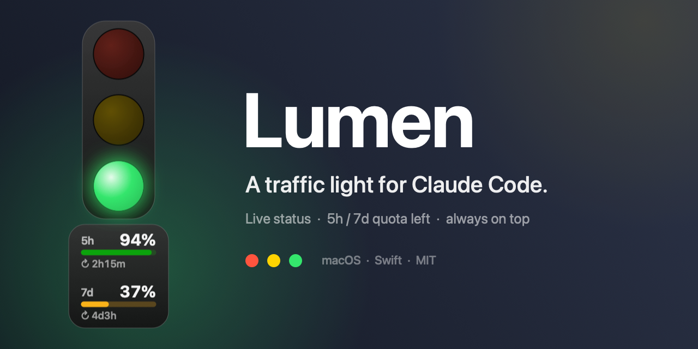
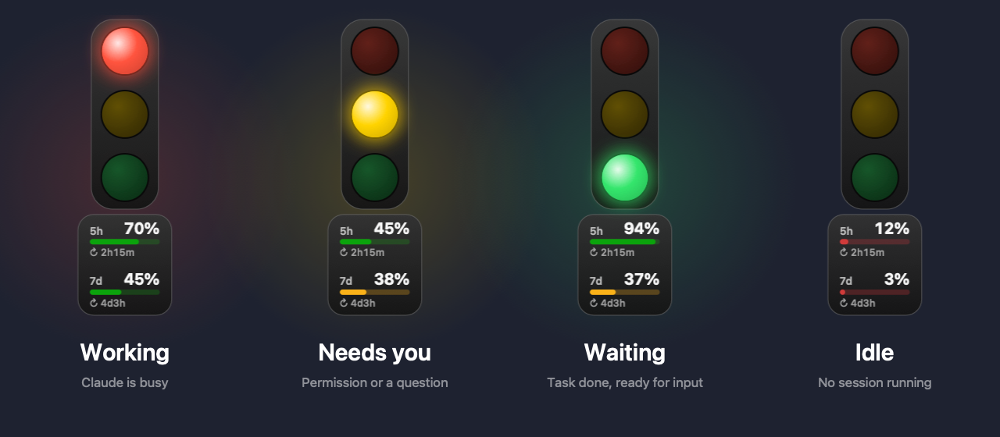
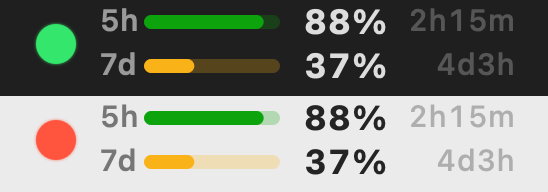

<div align="center">



# Lumen

**Eine schwebende Ampel für Claude Code – mit Live-Anzeige des verbleibenden Kontingents.**

[](#voraussetzungen)
[](Sources/main.swift)
[](https://github.com/ClarkeLi/Lumen/actions/workflows/build.yml)
[](LICENSE)

[English](README.md) · [简体中文](README.zh-CN.md) · Deutsch

</div>

Lumen schwebt über allen Fenstern (und in der Menüleiste) und zeigt auf einen Blick, was Claude Code gerade tut – du kannst wegschauen, solange es arbeitet, und kommst genau dann zurück, wenn es dich braucht. Unter der Ampel zeigt ein kleines Messgerät, wie viel von deinem **5-Stunden- und 7-Tage**-Abo-Kontingent noch **übrig** ist und wie lange es bis zum **Reset** dauert.

<div align="center">

</div>

## Funktionen

- **Immer sichtbare Ampel** + Menüleisten-Symbol, verschiebbar, Position wird gespeichert
- **Vier Zustände**, gesteuert über Claude-Code-Hooks – kein Auslesen der Terminalausgabe
- **Mehrere Sessions**: Bei mehreren laufenden Sessions gewinnt die dringendste (🟡 > 🔴 > 🟢)
- **Kontingent-Anzeige**: verbleibende Prozent für das 5h- und 7d-Fenster, farbige Balken und ein Live-Countdown bis zum nächsten Reset
- **Menüleisten-Anzeige**: zwei Zeilen (5h oben, 7d unten) mit Balken, verbleibenden Prozent und Zeit bis zum Reset – immer im Blick

<p align="center"></p>

- Drei Größen, Start bei der Anmeldung, Hooks mit einem Klick entfernen, keine Abhängigkeiten

| Licht | Bedeutung | Ausgelöst durch |
|---|---|---|
| 🔴 | Arbeitet | `UserPromptSubmit`, `PreToolUse`, `PostToolUse` |
| 🟡 (blinkt) | Braucht dich | `PermissionRequest`, Berechtigungs-Hinweise, `AskUserQuestion`, `ExitPlanMode` |
| 🟢 | Fertig, wartet auf Eingabe | `Stop`, `SessionStart`, Abbruch durch den Nutzer (Esc) |
| ⚪️ | Kein Claude Code aktiv | – |

## Installation

```sh
git clone https://github.com/ClarkeLi/Lumen.git
cd Lumen
./build.sh --install   # bauen, nach ~/Applications kopieren und starten
```

Beim ersten Start trägt Lumen seine Hooks in `~/.claude/settings.json` ein (das Original wird als `settings.json.trafficlight-backup` gesichert). Neu gestartete Claude-Code-Sessions werden automatisch erkannt.

> **Hinweis:** Menü und Tooltips sind derzeit auf Chinesisch. Übersetzungen als Pull Request sind willkommen.

## Bedienung

- Ampel ziehen zum Verschieben; Rechtsklick öffnet das Menü
- Menüleiste: ein/aus, schwebende Ampel ein-/ausblenden, Kontingent ein-/ausblenden, Kontingent in der Menüleiste, Größe, Start bei der Anmeldung, Hooks entfernen, Beenden

## Kontingent-Anzeige

Angezeigt wird, was **übrig** ist – nicht, was verbraucht wurde:

- Balkenfarbe: > 40 % grün, 15–40 % gelb, < 15 % rot. `--` heißt: noch keine Daten; Werte, die älter als 10 Minuten sind, werden abgedunkelt
- `↻ 2h14m` unter jedem Balken ist die Zeit bis zum Reset des Fensters; dieselben Werte stehen in der Menüleiste (zwei Balken). Mit dem Mauszeiger über der Ampel oder im Menü siehst du den genauen Zeitpunkt
- Sobald ein Fenster zurückgesetzt wird, aktualisiert Lumen die Werte sofort
- Die Menüleisten-Anzeige lässt sich im Menü separat ausschalten
- **Datenquelle:** Alle 3 Minuten liest Lumen das OAuth-Token von Claude Code aus dem macOS-Schlüsselbund (`Claude Code-credentials`) und ruft `api.anthropic.com/api/oauth/usage` auf. Das ist ein **nicht dokumentierter Endpunkt**, der sich jederzeit ändern oder wegfallen kann. Das Token wird nur für diese Anfrage verwendet und nie gespeichert
- macOS fragt beim ersten Zugriff ggf. nach Schlüsselbund-Zugriff – „Immer erlauben“ wählen
- Im Menü „Kontingent anzeigen“ deaktivieren: Lumen ist wieder eine reine Ampel und sendet keine Anfragen

## Voraussetzungen

- macOS 13 oder neuer, Xcode Command Line Tools (`xcode-select --install`)
- Keine Abhängigkeiten – die ganze App ist `Sources/main.swift`
- `./build.sh` baut eine Universal-App (Apple Silicon + Intel) nach `build/`; `./build.sh --install` installiert sie zusätzlich

## Datenschutz & Haftungsausschluss

- Alle Statusdaten bleiben auf deinem Rechner in `~/.claude/traffic-light/`
- Die Kontingent-Funktion kommuniziert ausschließlich mit `api.anthropic.com`
- Lumen ist ein inoffizielles Community-Projekt und steht in keiner Verbindung zu Anthropic. Claude ist eine Marke von Anthropic

## Lizenz

[MIT](LICENSE) © Clarke Li
