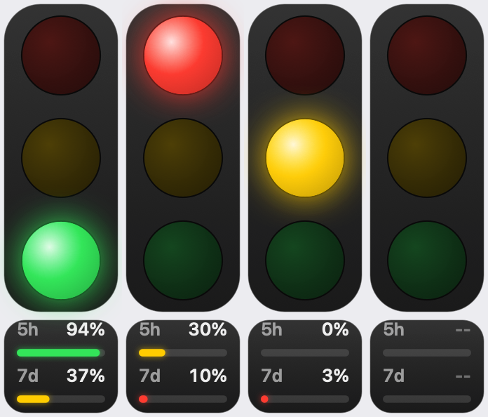

# Claude Code 红绿灯

  

置顶悬浮的红绿灯 + 菜单栏图标，实时显示 Claude Code 状态，并在下方显示订阅 5h / 7d 窗口的剩余额度。



| 灯 | 含义 | 触发 |
|---|---|---|
| 🔴 | 工作中 | `UserPromptSubmit`、`PreToolUse`、`PostToolUse` |
| 🟡（闪烁） | 需要人介入 | `PermissionRequest`、权限通知、`AskUserQuestion`、`ExitPlanMode` |
| 🟢 | 任务停止，等待输入 | `Stop`、`SessionStart`、用户按 Esc 中断 |
| ⚪️ | 没有运行中的 Claude Code | — |

多个会话同时运行时：🟡 > 🔴 > 🟢。

## 额度显示

红绿灯下方的小面板显示 Claude 订阅 **5 小时 / 7 天窗口的剩余额度**（百分比 + 进度条）：

- 进度条颜色：剩余 > 40% 绿，15–40% 黄，< 15% 红；拿不到数据显示 `--`，数据超过 10 分钟没更新会变暗
- 鼠标悬停 / 菜单里可看到各窗口的重置时间
- 数据来源：用本机 Claude Code 登录凭证（钥匙串 `Claude Code-credentials`）每 3 分钟请求一次 `api.anthropic.com/api/oauth/usage`（非公开接口，将来可能变动）；凭证只用于这次请求，不会保存
- 首次读取钥匙串时 macOS 可能弹窗，选「始终允许」即可
- 菜单 →「显示额度」可随时关闭，关闭后恢复原来的纯红绿灯，也不再发请求

## 安装

```sh
./build.sh --install   # 编译、复制到 ~/Applications 并启动
```

首次启动会自动把 hooks 写入 `~/.claude/settings.json`（原文件备份为 `settings.json.trafficlight-backup`）。
新开的 Claude Code 会话即可被识别。

## 使用

- 拖动红绿灯可移动位置（自动记住）；右键红绿灯 = 菜单栏菜单
- 菜单栏：开启/关闭、显示/隐藏悬浮灯、大小、开机启动、卸载 hooks、退出

## 系统要求与构建

- macOS 13+，需要 Xcode Command Line Tools（`xcode-select --install`）
- 无第三方依赖，整个应用只有 `Sources/main.swift` 一个文件
- `./build.sh` 只构建（输出到 `build/`），`./build.sh --install` 构建并安装

## 隐私与免责

- 所有状态数据都只保存在本机 `~/.claude/traffic-light/`
- 额度功能仅向 `api.anthropic.com` 发起请求，使用的是非公开接口，随时可能失效
- 本项目为非官方项目，与 Anthropic 无关；Claude 是 Anthropic 的商标

## 许可证

[MIT](LICENSE)
