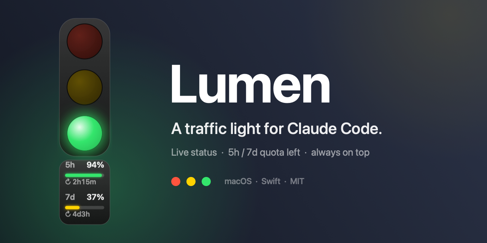
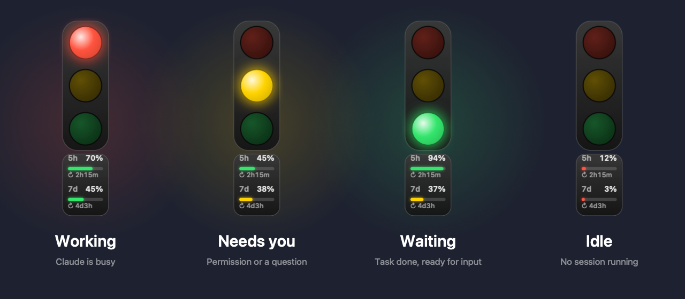

<div align="center">



# Lumen

**A floating traffic light for Claude Code – and a live gauge of your remaining quota.**

[](#requirements)
[](Sources/main.swift)
[](https://github.com/ClarkeLi/Lumen/actions/workflows/build.yml)
[](LICENSE)

English · [简体中文](README.zh-CN.md) · [Deutsch](README.de.md)

</div>

Lumen sits on top of your windows (and in the menu bar) and tells you at a glance what Claude Code is doing – so you can look away while it works and come back exactly when it needs you. Below the light, a small gauge shows how much of your **5-hour and 7-day** subscription quota is **left** and how long until each window **resets**.

<div align="center">

</div>

## Features

- **Always-on-top traffic light** + menu bar icon, draggable, position is remembered
- **Four states** driven by Claude Code hooks – no polling of terminal output
- **Multi-session aware** – with several sessions running, the most urgent one wins (🟡 > 🔴 > 🟢)
- **Quota gauge** – remaining % for the 5h and 7d windows with colour-coded bars and a live countdown to the next reset
- **Menu bar readout** – e.g. `🟢 5h 94%·2h14m 7d 37%·4d3h`: remaining quota and time until reset, always visible
- Three sizes, launch at login, one-click hook uninstall, zero dependencies

| Light | Meaning | Triggered by |
|---|---|---|
| 🔴 | Working | `UserPromptSubmit`, `PreToolUse`, `PostToolUse` |
| 🟡 (blinking) | Needs you | `PermissionRequest`, permission notifications, `AskUserQuestion`, `ExitPlanMode` |
| 🟢 | Done, waiting for input | `Stop`, `SessionStart`, user interrupt (Esc) |
| ⚪️ | No Claude Code running | – |

## Install

```sh
git clone https://github.com/ClarkeLi/Lumen.git
cd Lumen
./build.sh --install   # build, copy to ~/Applications and launch
```

On first launch Lumen writes its hooks into `~/.claude/settings.json` (the original is backed up as `settings.json.trafficlight-backup`). Newly started Claude Code sessions are picked up automatically.

> **Note:** the menu and tooltips are currently in Chinese. Translations are welcome as pull requests.

## Usage

- Drag the light to move it; right-click it for the menu
- Menu bar: enable/disable, show/hide the floating light, show/hide the quota gauge, menu bar quota readout, size, launch at login, uninstall hooks, quit

## Quota gauge

The gauge shows what is **left**, not what is used:

- Bar colour: > 40 % green, 15–40 % yellow, < 15 % red. `--` means no data yet; values older than 10 minutes are dimmed
- `↻ 2h14m` under each bar is the time until that window resets; the same numbers appear in the menu bar (`5h 94%·2h14m`). Hover the light or open the menu for the exact reset time
- When a window resets, Lumen refreshes the numbers right away
- The menu bar readout can be turned off separately in the menu
- **Data source:** every 3 minutes Lumen reads Claude Code's OAuth token from the macOS Keychain (`Claude Code-credentials`) and calls `api.anthropic.com/api/oauth/usage`. This is an **undocumented endpoint** and may change or stop working at any time. The token is used only for this request and never stored
- macOS may ask for Keychain access on first use – choose "Always Allow"
- Turn it off in the menu ("Show quota") and Lumen goes back to a plain traffic light and makes no requests

## Requirements

- macOS 13 or later, Xcode Command Line Tools (`xcode-select --install`)
- No third-party dependencies – the whole app is `Sources/main.swift`
- `./build.sh` builds a universal (Apple Silicon + Intel) app into `build/`; `./build.sh --install` also installs it

## Privacy & disclaimer

- All state stays on your machine in `~/.claude/traffic-light/`
- The quota feature only talks to `api.anthropic.com`
- Lumen is an unofficial community project and is not affiliated with Anthropic. Claude is a trademark of Anthropic

## License

[MIT](LICENSE) © Clarke Li
