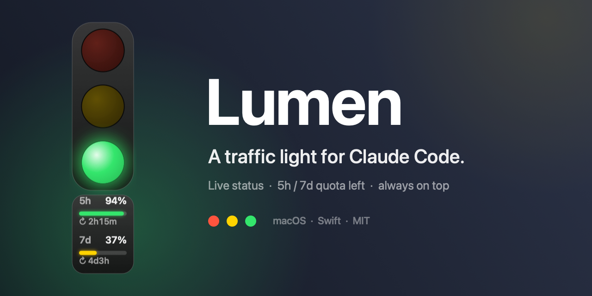
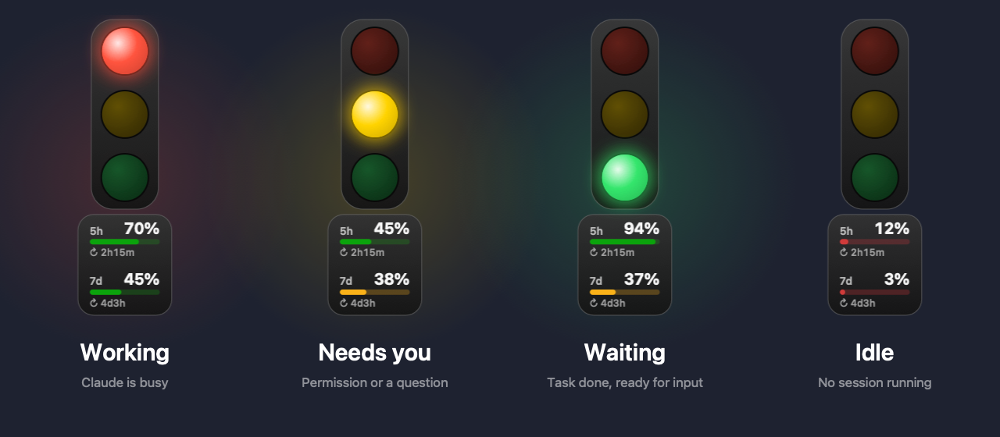
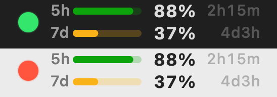

<div align="center">



# Lumen

**Claude Code 的悬浮红绿灯，外加实时的剩余额度仪表。**

[](#系统要求)
[](Sources/main.swift)
[](https://github.com/ClarkeLi/Lumen/actions/workflows/build.yml)
[](LICENSE)

[English](README.md) · 简体中文 · [Deutsch](README.de.md)

</div>

Lumen 置顶悬浮在所有窗口之上（同时在菜单栏显示），一眼看清 Claude Code 此刻在做什么——它干活时你可以放心去做别的事，它需要你时刚好回来。红绿灯下方的小面板显示订阅 **5 小时 / 7 天**窗口的**剩余**额度，以及距离**下次刷新**还有多久。

<div align="center">

</div>

## 特性

- **置顶红绿灯** + 菜单栏图标，可拖动，自动记住位置
- **五种状态**由 Claude Code hooks 和会话 transcript 驱动，无需轮询终端输出
- **感知后台任务**：Claude 本轮结束、但后台 Bash、`Monitor` 或后台 Agent 仍在运行时，红灯保持亮起并套一圈呼吸的蓝环，而不是容易误导的 🟢；悬停提示和菜单会说明在跑什么（如 `Shell ×2 · Monitor ×1`）
- **多会话感知**：同时运行多个会话时，取最紧急的一个（🟡 > 🔴 > 🔴+蓝环 > 🟢）
- **额度仪表**：5h / 7d 窗口的剩余百分比，进度条按剩余量变色，并实时倒计时距离下次刷新还有多久
- **菜单栏读数**：上下两行（5h 在上，7d 在下），每行有进度条、剩余百分比和刷新倒计时，随时可见

<p align="center"></p>

- **多语言界面**：English、简体中文、Deutsch，自动跟随系统语言，运行中切换也会同步（其他语言回退为英文）
- 三种大小、开机启动、一键卸载 hooks、零依赖

| 灯 | 含义 | 触发 |
|---|---|---|
| 🔴 | 工作中 | `UserPromptSubmit`、`PreToolUse`、`PostToolUse` |
| 🔴 + 蓝环（呼吸） | 本轮已结束，但后台任务（Bash `run_in_background`、`Monitor`、后台 Agent）仍在运行，完成后 Claude 会继续 | `Stop` + transcript 中存在未完成的后台任务 |
| 🟡（闪烁） | 需要人介入 | `PermissionRequest`、权限通知、`AskUserQuestion`、`ExitPlanMode` |
| 🟢 | 任务停止，等待输入 | `Stop`、`SessionStart`、用户按 Esc 中断 |
| ⚪️ | 没有运行中的 Claude Code | – |

## 安装

**下载：** 从 [Releases](https://github.com/ClarkeLi/Lumen/releases/latest) 下载 `Lumen-1.0.0-macos-universal.zip`（Apple 芯片 + Intel 通用），解压后把 `Lumen.app` 拖进「应用程序」。应用没有经过公证，首次打开请右键 →「打开」，或执行 `xattr -cr /Applications/Lumen.app`。

**或者从源码构建：**

```sh
git clone https://github.com/ClarkeLi/Lumen.git
cd Lumen
./build.sh --install   # 编译、复制到 ~/Applications 并启动
```

首次启动会自动把 hooks 写入 `~/.claude/settings.json`（原文件备份为 `settings.json.trafficlight-backup`）。新开的 Claude Code 会话即可被识别。

## 使用

- 拖动红绿灯可移动位置；右键红绿灯 = 菜单栏菜单
- 菜单栏：开启/关闭、显示/隐藏悬浮灯、显示/隐藏额度、菜单栏额度读数、大小、开机启动、卸载 hooks、退出

## 额度仪表

仪表显示的是**剩余**而不是已用：

- 进度条颜色：剩余 > 40% 绿，15–40% 黄，< 15% 红；`--` 表示还没拿到数据；数据超过 10 分钟没更新会变暗
- 每个进度条下的 `↻ 2h14m` 是距离该窗口重置的剩余时间；菜单栏里同样显示（两行进度条）。鼠标悬停红绿灯或打开菜单可看到具体的重置时刻
- 窗口重置时 Lumen 会立即刷新数据
- 菜单栏读数可以在菜单中单独关闭
- **数据来源**：每 3 分钟从 macOS 钥匙串读取 Claude Code 的 OAuth 凭证（`Claude Code-credentials`），请求 `api.anthropic.com/api/oauth/usage`。这是**非公开接口**，随时可能变动或失效。凭证只用于这次请求，不会保存
- 首次读取钥匙串时 macOS 可能弹窗，选「始终允许」即可
- 在菜单中关闭「显示额度」后，Lumen 恢复为纯红绿灯，也不再发任何请求

## 系统要求

- macOS 13+，Xcode Command Line Tools（`xcode-select --install`）
- 无第三方依赖，整个应用只有 `Sources/main.swift` 一个文件
- `./build.sh` 构建通用二进制（Apple 芯片 + Intel）到 `build/`；`./build.sh --install` 同时安装

## 隐私与免责

- 所有状态数据只保存在本机 `~/.claude/traffic-light/`
- 额度功能只会访问 `api.anthropic.com`
- Lumen 是非官方的社区项目，与 Anthropic 无关；Claude 是 Anthropic 的商标

## 许可证

[MIT](LICENSE) © Clarke Li
